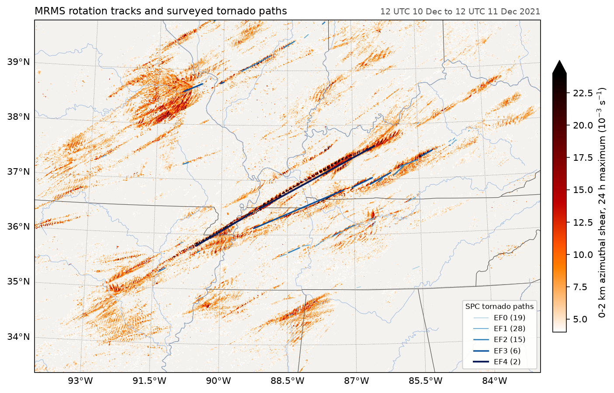

# fastplot

[](https://github.com/Rochy111/fastplot/actions/workflows/tests.yml)
[](https://rochy111.github.io/fastplot/)

fastplot draws weather maps and scientific plots with the matplotlib and
cartopy interface. It renders directly to pixels with numba on every CPU
core, or with CUDA on an NVIDIA GPU, instead of building matplotlib's artist
tree and reprojecting polygons. A global GFS map with filled contours,
labelled contours, coastlines and a colorbar takes 14.5 ms to draw and
save; matplotlib and cartopy take about 14 seconds for the same figure.

**Documentation:** https://rochy111.github.io/fastplot/ ·
**Changes:** [CHANGELOG.md](CHANGELOG.md)



## Installation

```bash
pip install git+https://github.com/Rochy111/fastplot
python -m fastplot warm      # compile the kernels once, about 12 s
```

Python 3.9 or later, on Linux, Windows or macOS. The dependencies are numpy,
numba, Pillow and freetype-py (text is rasterised by FreeType glyph by glyph,
as matplotlib 3.11 draws it). Install the `gpu` extra to draw on an NVIDIA GPU with
cupy.

## Usage

Scripts written for matplotlib and cartopy usually run after changing their
imports:

```python
import fastplot.pyplot as plt          # matplotlib.pyplot
import fastplot.crs as ccrs            # cartopy.crs

fig = plt.figure(figsize=(10, 5.5), dpi=150)
ax = fig.add_subplot(projection=ccrs.Robinson())
cf = ax.contourf(lon, lat, t2m, levels=range(-40, 46, 2), cmap='RdYlBu_r',
                 extend='both', transform=ccrs.PlateCarree())
ax.coastlines(linewidth=0.5)
fig.colorbar(cf, ax=ax, orientation='horizontal', label='2 m temperature (°C)')
fig.savefig('t2m.png')
```

| Area | Coverage |
|---|---|
| Maps | 12 projections; `pcolormesh`, `contourf`, `contour`, `clabel`, barbs, quiver, streamlines; Natural Earth features; labelled gridlines |
| Plots | Lines, scatter, bars, histograms, fills, error bars, box and violin plots, pies, hexbins, log and date axes, twin, shared, inset and secondary axes, constrained layout, legends, annotations, patches, polar axes, triangulations |
| Meteorology | MetPy's `SkewT` and `Hodograph` |
| Style | `rcParams`, matplotlib's style sheets, all built-in colormaps and norms |

The [gallery](https://rochy111.github.io/fastplot/gallery/) has complete
examples using real data, and the
[differences page](https://rochy111.github.io/fastplot/reference/differences/)
lists where fastplot's output departs from matplotlib's.

## Performance

| One figure, PNG written | matplotlib (+ cartopy) | fastplot |
|---|---:|---:|
| Global map: contourf, contours, labels, coastlines, colorbar | 14,016 ms | 14.5 ms |
| Lambert CONUS: contourf, contours, states | 23,492 ms | 12.0 ms |
| pcolormesh with 1,800 wind barbs | 1,952 ms | 11.8 ms |
| Skew-T with adiabats, CAPE and CIN | 70.8 ms | 6.8 ms |
| Scatter, 20,000 points | 158.8 ms | 4.9 ms |

Measured on an Intel i7-13700K. A fresh process that draws one map and saves
it takes 0.8 to 1.1 seconds in all. Thread counts and the CPU/GPU choice are
derived from the hardware at import time; see the
[performance page](https://rochy111.github.io/fastplot/speed/).

## Related projects

[fastgrib](https://github.com/Rochy111/fastgrib) decodes GRIB2 and GRIB1
files into numpy arrays and is used for the examples here.

## Licence

MIT. Natural Earth data is in the public domain, and the bundled DejaVu
fonts have their own licence. See [LICENSE](LICENSE) and [NOTICE](NOTICE).
