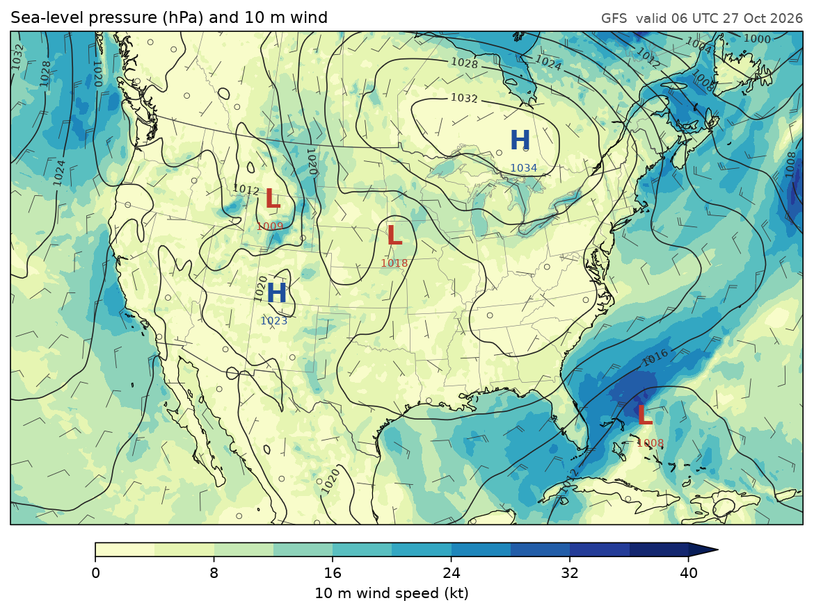
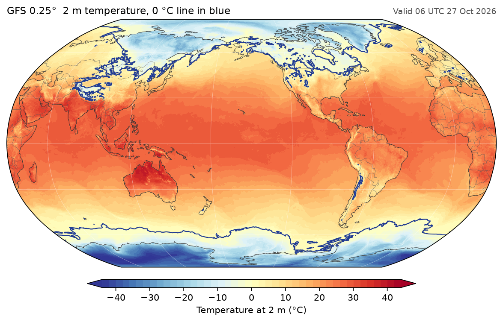
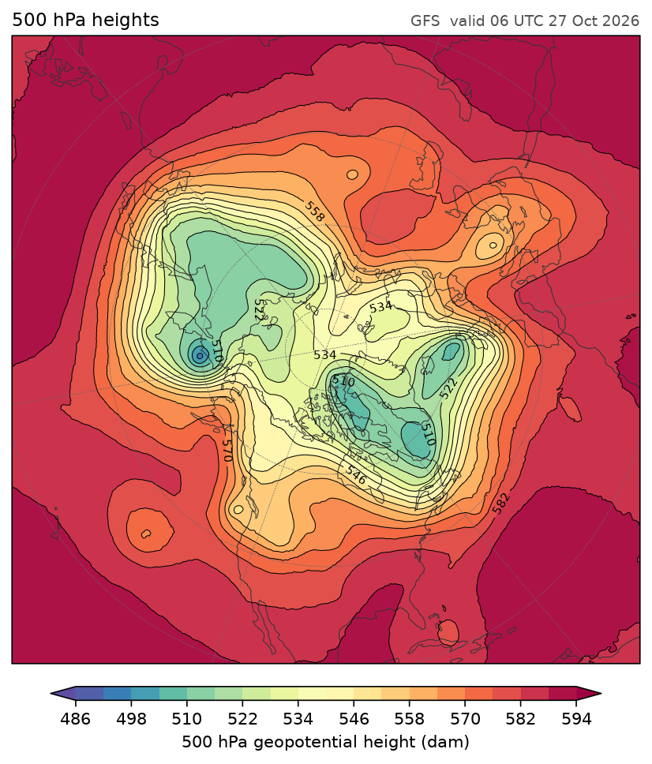
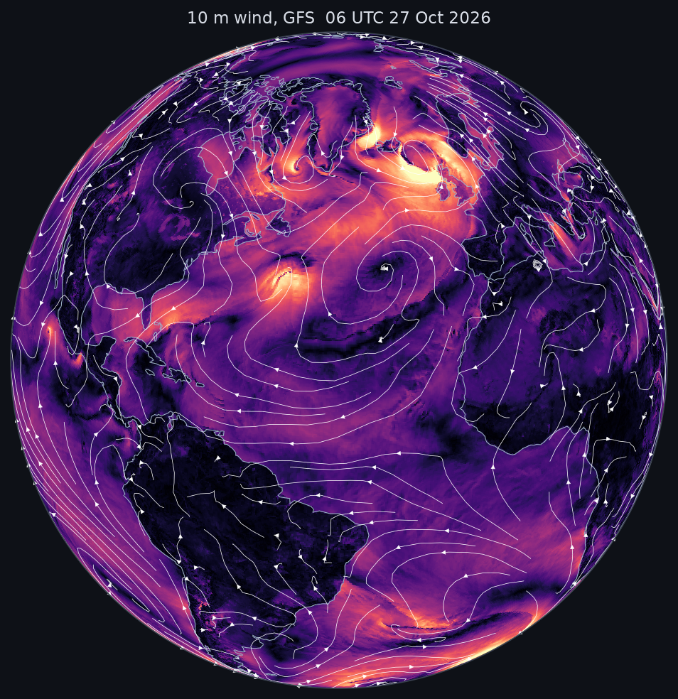
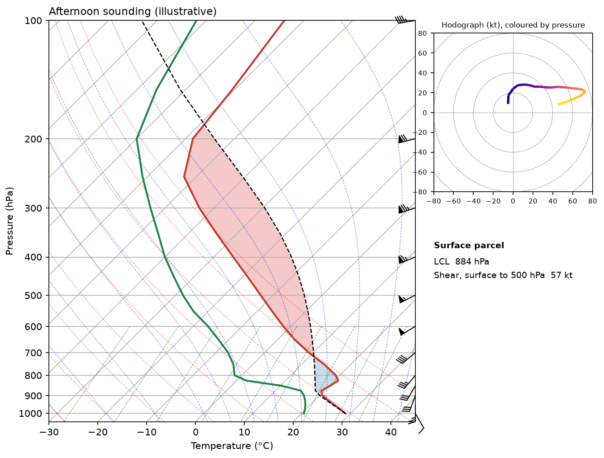
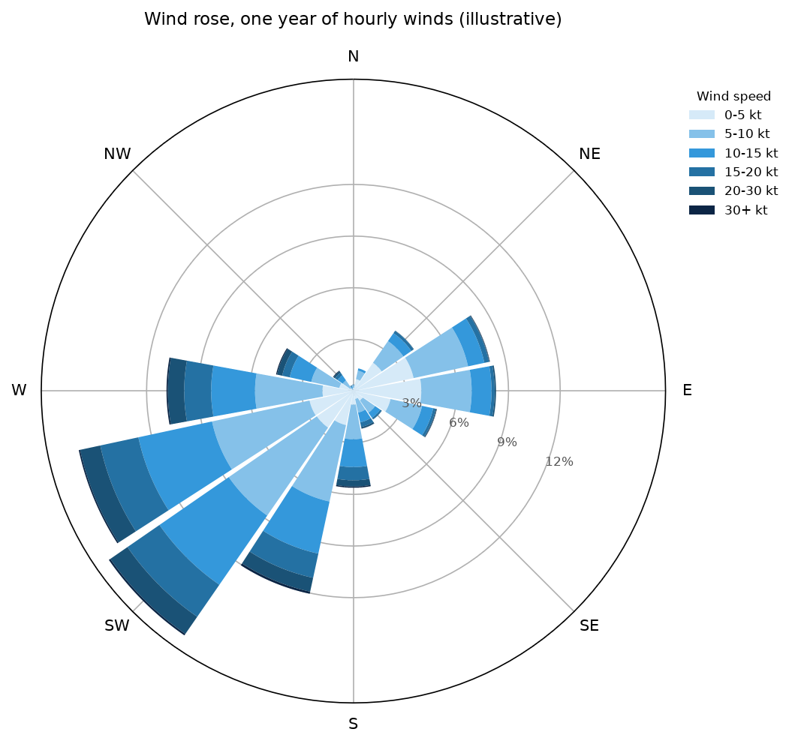

# Gallery

Every picture here was drawn by fastplot from the script under it. The maps
use one real GFS run (00 UTC 27 October 2026, six-hour forecast), read with
[fastgrib](https://rochy111.github.io/fastgrib/) straight from NOAA's archive
on AWS. The sounding, meteogram and wind rose use made-up data, built to
behave like the real thing.

To run a map script against a file you already have, set `GFS_FILE`:

```bash
GFS_FILE=gfs.t00z.pgrb2.0p25.f006 python docs/examples/surface_analysis.py
```

## Surface analysis

Sea-level pressure, lightly smoothed, with highs and lows marked, over 10 m
wind speed and barbs on a Lambert conformal map.



??? example "surface_analysis.py"
    ```python
    --8<-- "surface_analysis.py"
    ```

## Global temperature

2 m temperature on a Robinson map centred on the Pacific, with the 0 °C line
picked out.



??? example "global_temperature.py"
    ```python
    --8<-- "global_temperature.py"
    ```

## 500 hPa from the pole

The jet stream's troughs and ridges, seen from above the North Pole.



??? example "polar_heights.py"
    ```python
    --8<-- "polar_heights.py"
    ```

## Wind on a globe

10 m wind speed on an orthographic globe, with streamlines tracing the flow.



??? example "wind_globe.py"
    ```python
    --8<-- "wind_globe.py"
    ```

## A sounding

A Skew-T with the surface parcel's CAPE and CIN shaded, wind barbs, and a
hodograph coloured by pressure.



??? example "sounding.py"
    ```python
    --8<-- "sounding.py"
    ```

## A meteogram

Five days at one place, with a cold front on the third: temperature and
dewpoint, wind and gusts with barbs, and pressure with hourly rain on a
second axis.


??? example "meteogram.py"
    ```python
    --8<-- "meteogram.py"
    ```

## A wind rose

How often the wind blows from each direction, and how hard, as stacked bars
on polar axes.



??? example "wind_rose.py"
    ```python
    --8<-- "wind_rose.py"
    ```

## How fast

The time to draw and save one frame, against matplotlib and cartopy. The
chart is drawn by fastplot too.


??? example "speed_chart.py"
    ```python
    --8<-- "speed_chart.py"
    ```
