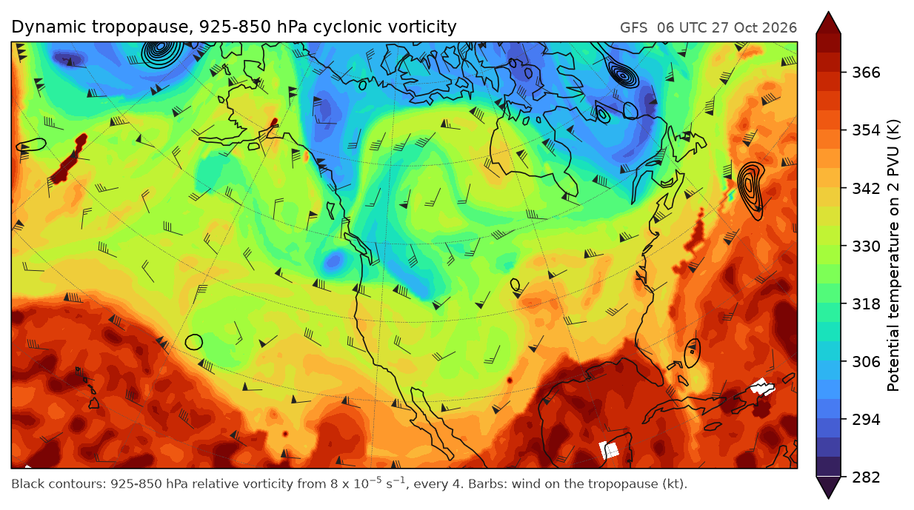
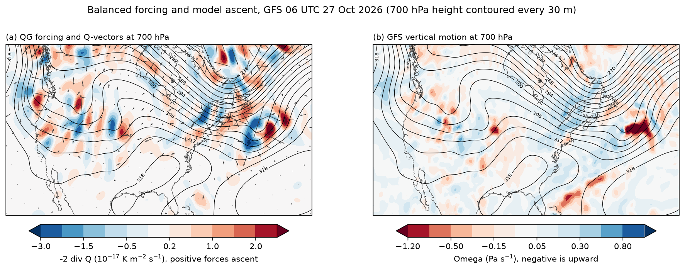
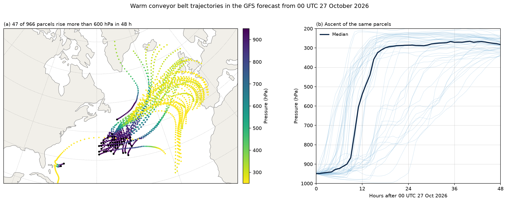
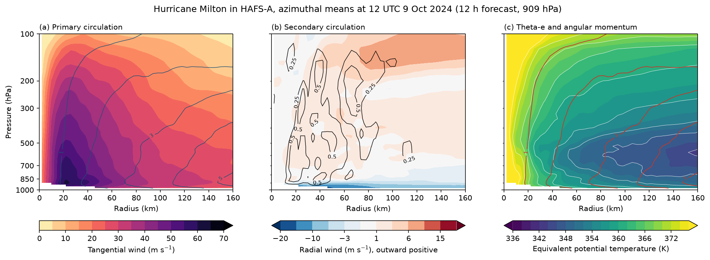
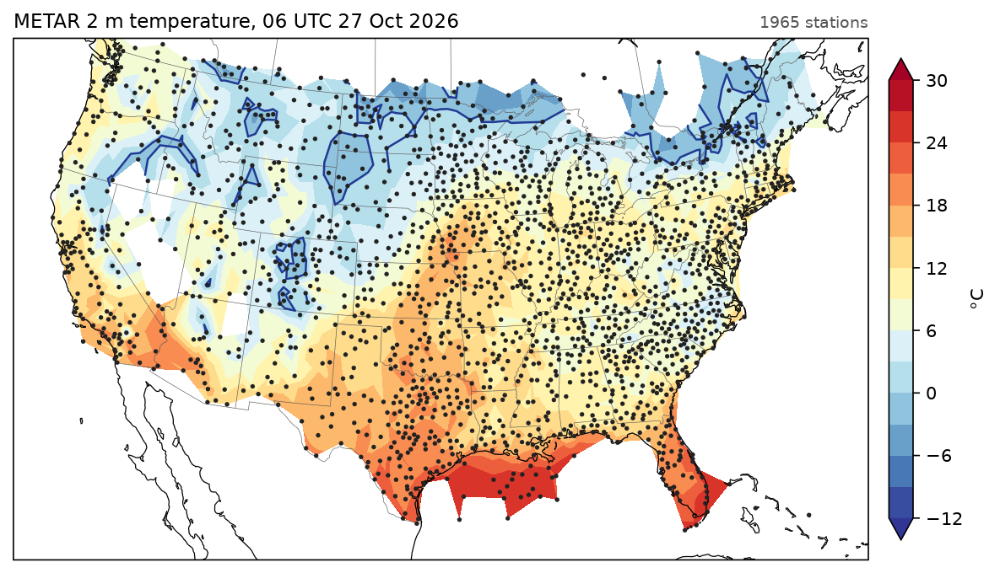
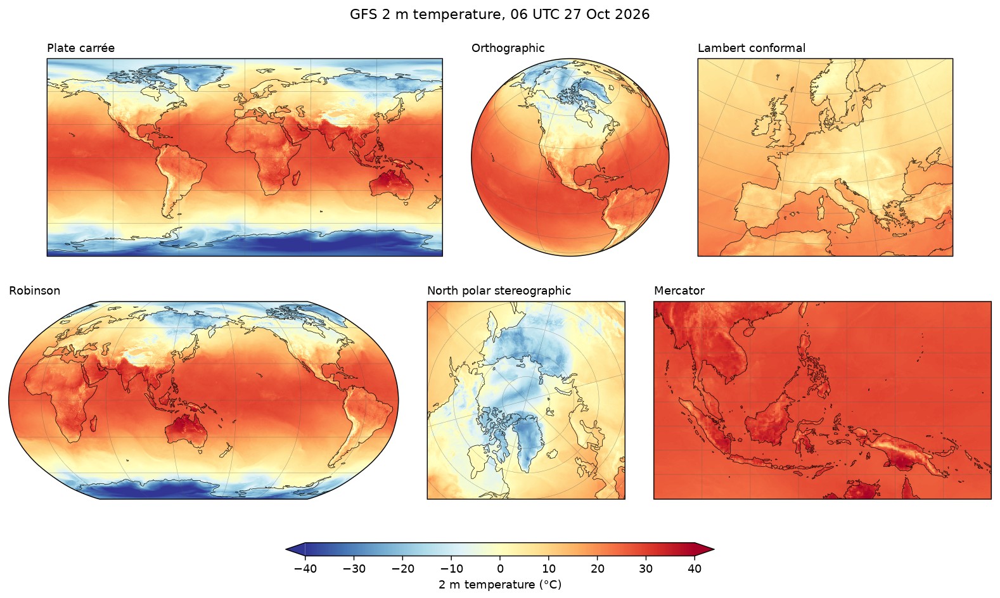

---
hide:
  - toc
---

# Gallery

Each example is a complete script with the figure it produces, and all of them use real data: model output from GFS, HAFS and MRMS, and METAR, radiosonde, ASOS and Storm Prediction Center records. The scripts are in `docs/examples/`.

## Atmospheric dynamics

<a class="card" href="dynamic_tropopause/">

Dynamic tropopause mapPotential temperature and wind on the 2 PVU surface

</a>
<a class="card" href="qg_forcing/">

Quasi-geostrophic forcing and model ascentQ-vector forcing against the GFS vertical motion at 700 hPa

</a>
<a class="card" href="warm_conveyor/">

Warm conveyor belt trajectoriesAir parcels rising 600 hPa in 48 hours of GFS forecast

</a>

## Storms

<a class="card" href="hafs_milton/">

Hurricane vortex structureMilton in the 2 km HAFS-A storm nest

</a>
<a class="card" href="tornado_tracks/">

Rotation tracks and tornado pathsThe 10-11 December 2021 outbreak

</a>

## Maps

<a class="card" href="surface_analysis/">

Surface analysisSea-level pressure and 10 m wind over North America

</a>
<a class="card" href="station_analysis/">

METAR temperature analysisTriangulated contours of 1,965 reports

</a>
<a class="card" href="projections/">

GFS 2 m temperature on six projectionsPlate carrée, orthographic, Lambert, Robinson, polar stereographic and Mercator

</a>

## Observations

<a class="card" href="sounding/">

Skew-T and hodographBirmingham, Alabama, 18 UTC 27 April 2011

</a>
<a class="card" href="meteogram/">

Blizzard meteogramBuffalo airport, 22-27 December 2022

</a>
<a class="card" href="wind_rose/">

Wind roseHourly winds at Amarillo, Texas, in 2025

</a>

