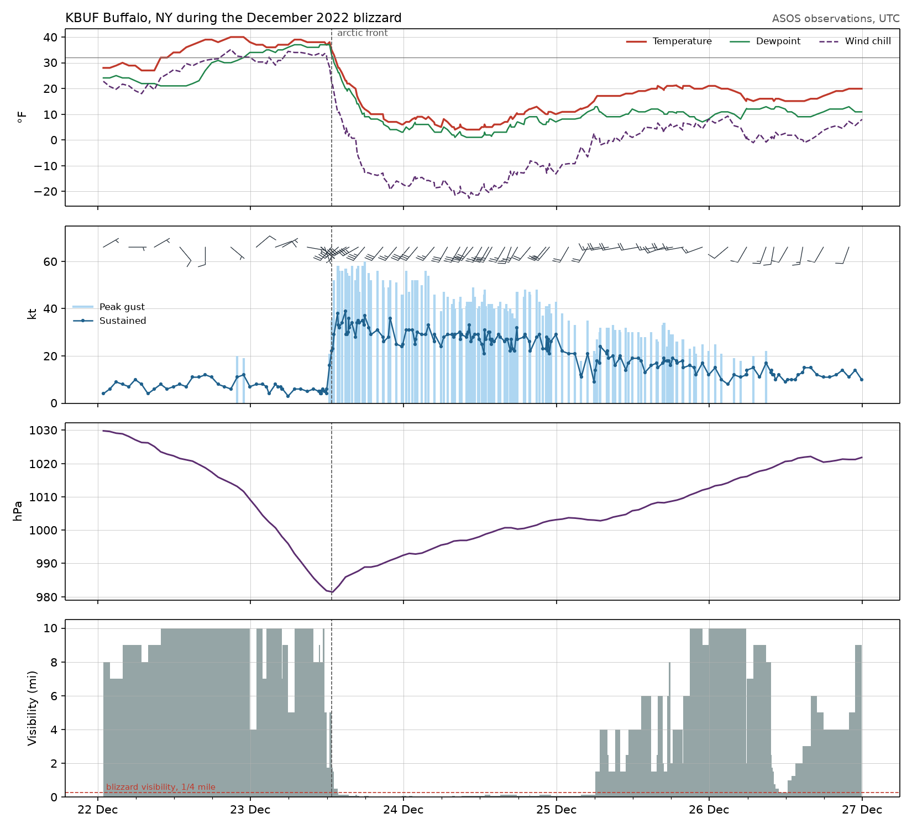

# Blizzard meteogram

Every routine and special observation at Buffalo Niagara airport through the December 2022 blizzard. An arctic front arrives on the morning of the 23rd: the temperature falls from 38 °F to 6 °F in twelve hours, gusts reach 60 kt off Lake Erie, and visibility stays near zero for most of two days. The wind chill is computed with the NWS formula.



Data: Iowa Environmental Mesonet ASOS archive, saved in `docs/examples/data/asos_BUF_blizzard.csv`.

```python title="docs/examples/meteogram.py"
--8<-- "meteogram.py"
```
