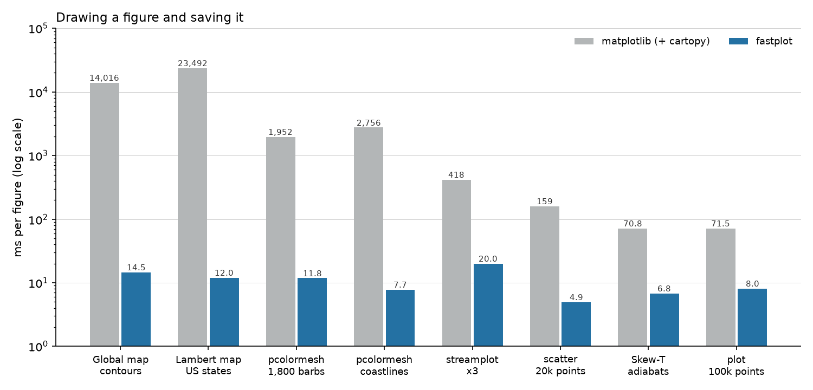

# Speed

All times are for warm frames (each a new figure, PNG written), measured on
Windows 11 with an Intel i7-13700K (8 performance and 8 efficiency cores)
and an RTX 5070 Ti. fastplot's numbers are the median of 9 runs and
matplotlib's the median of 5, since its times vary by about 30% between
runs. The scripts are in `tools/`, so you can measure your own machine.

## Maps

One GFS 0.25° field (1440 x 721) at 1800 x 975 pixels, `tools/bench.py`:

| Figure | matplotlib + cartopy | fastplot CPU | fastplot GPU | Speed-up |
|---|---:|---:|---:|---:|
| `pcolormesh` | 2,177 ms | 6.1 ms | 6.7 ms | 360x |
| `contourf`, 43 levels | 18,831 ms | 5.1 ms | 5.3 ms | 3,700x |
| `contour` + `clabel` | 2,205 ms | 14.9 ms | 14.0 ms | 150x |
| pcolormesh, coastlines, borders, gridline labels, colorbar | 2,756 ms | 7.7 ms | 7.6 ms | 360x |
| contourf and the same | 19,495 ms | 7.0 ms | 6.5 ms | 2,800x |
| contourf, contour and the same | 14,016 ms | 14.5 ms | 14.5 ms | 970x |
| Lambert CONUS: contourf, contour, states | 23,492 ms | 12.0 ms | 11.3 ms | 1,950x |
| pcolormesh and 1,800 wind barbs | 1,952 ms | 11.8 ms | 11.5 ms | 165x |

Most of cartopy's time goes into reprojecting polygons one by one, which
fastplot never does. Plain matplotlib without cartopy is quicker, at about
185 ms for `imshow`, 370 ms for `pcolormesh` and 650 ms for `contourf` of the
same field, so on non-map figures the gain is more like 10 to 30 times.

## Plots

800 x 500 pixels, `tools/bench_plain.py`, CPU:

| Figure | matplotlib | fastplot | Speed-up |
|---|---:|---:|---:|
| `plot`, 100k points | 71.5 ms | 8.0 ms | 9x |
| `scatter`, 20k points coloured by value | 158.8 ms | 4.9 ms | 32x |
| `hist`, 1M values, 100 bins | 63.6 ms | 3.3 ms | 19x |
| `bar` (50) with error bars | 78.2 ms | 3.1 ms | 25x |
| `pcolormesh` 500 x 500 | 163.6 ms | 4.5 ms | 36x |
| `contourf` + `contour` 300 x 200 | 83.3 ms | 4.3 ms | 19x |
| `imshow` RGB 600 x 400 | 106.1 ms | 3.9 ms | 27x |
| Log-pressure `fill_betweenx` | 68.5 ms | 2.7 ms | 25x |
| Skew-T with barbs, CAPE/CIN, adiabats and mixing lines, 700 x 700 | 70.8 ms | 6.8 ms | 10x |
| `streamplot` x3, including integration | 418 ms | 20 ms | 21x |
| Two hodographs with rings, coloured lines and vectors | 52.3 ms | 5.8 ms | 9x |
| `tricontourf`, `tricontour` + `clabel`, `tripcolor` x2, `triplot` (400 points) | 109.3 ms | 8.5 ms | 13x |

## Where the time goes

matplotlib builds a tree of Python artist objects, and Agg paints their
paths one by one. cartopy first reprojects every polygon through shapely: a
global contourf is about 21,000 rings, each one a separate Python call.
fastplot works differently:

- **Fields are sampled per pixel.** Each pixel's map position is turned back
  into longitude and latitude and looked up in the grid. The cost depends on
  the size of the picture, not on how many contour shapes there would be.
- **Colour is a table lookup**, with matplotlib's band edges.
- **Lines are drawn in tiles.** Contour lines (the same lines as contourpy's),
  coastlines, borders, barbs and gridlines are cut into segments, sorted
  into 32 x 32 pixel tiles, and each tile is drawn anti-aliased on its own
  core.
- **Text is cached** as glyph masks, using FreeType through Pillow, with
  kerning and matplotlib's mathtext layout.
- **PNG compression** runs on every core.
- **Layout** is worked out once from text sizes, using the same rules as
  matplotlib's subplot parameters, gridspecs, aspect handling and colorbars.

## Start-up

A fresh process that imports fastplot, draws one full map and saves it takes
about a second, most of it numba loading its compiled kernels. matplotlib
and cartopy take over ten seconds for the same script. In a long-running
process, or with [`frames`](guide/frames.md), only the first figure pays
that.
