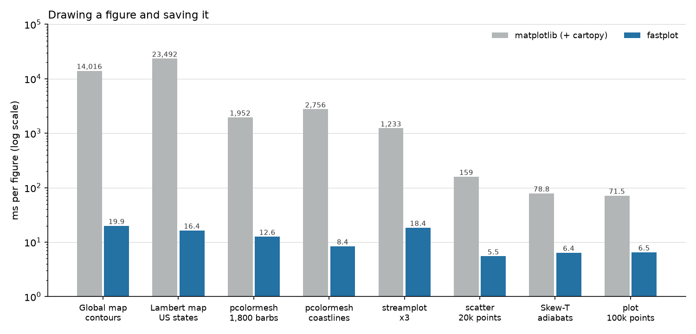

# Speed

All times are for warm frames (each a new figure, PNG written), measured on
Windows 11 with an Intel i7-13700K (8 performance and 8 efficiency cores)
and an RTX 5070 Ti. fastplot's numbers are the median of three runs of 9
frames each (7 for the plots), and matplotlib's the median of 5 or more
frames, since its times vary by about 30% between runs. The scripts are
in `tools/`, so you can measure your own machine.

## Maps

One GFS 0.25° field (1440 x 721) at 1800 x 975 pixels, `tools/bench.py`:

| Figure | matplotlib + cartopy | fastplot CPU | fastplot GPU | Speed-up |
|---|---:|---:|---:|---:|
| `pcolormesh` | 2,177 ms | 6.9 ms | 7.7 ms | 320x |
| `contourf`, 43 levels | 18,831 ms | 5.5 ms | 6.7 ms | 3,400x |
| `contour` + `clabel` | 2,205 ms | 18.8 ms | 19.0 ms | 120x |
| pcolormesh, coastlines, borders, gridline labels, colorbar | 2,756 ms | 8.4 ms | 8.7 ms | 330x |
| contourf and the same | 19,495 ms | 7.3 ms | 7.7 ms | 2,700x |
| contourf, contour and the same | 14,016 ms | 19.9 ms | 20.1 ms | 700x |
| Lambert CONUS: contourf, contour, states | 23,492 ms | 16.4 ms | 16.6 ms | 1,400x |
| pcolormesh and 1,800 wind barbs | 1,952 ms | 12.6 ms | 12.4 ms | 155x |

Most of cartopy's time goes into reprojecting polygons one by one, which
fastplot never does. Plain matplotlib without cartopy is quicker, at about
185 ms for `imshow`, 370 ms for `pcolormesh` and 650 ms for `contourf` of the
same field, so on non-map figures the gain is more like 10 to 30 times.

## Plots

800 x 500 pixels, `tools/bench_plain.py` (the last four rows:
`tools/bench_special.py`), CPU:

| Figure | matplotlib | fastplot | Speed-up |
|---|---:|---:|---:|
| `plot`, 100k points | 71.5 ms | 6.5 ms | 11x |
| `scatter`, 20k points coloured by value | 158.8 ms | 5.5 ms | 29x |
| `hist`, 1M values, 100 bins | 63.6 ms | 3.5 ms | 18x |
| `bar` (50) with error bars | 78.2 ms | 3.8 ms | 21x |
| `pcolormesh` 500 x 500 | 163.6 ms | 4.6 ms | 36x |
| `contourf` + `contour` 300 x 200 | 83.3 ms | 4.7 ms | 18x |
| `imshow` RGB 600 x 400 | 106.1 ms | 4.5 ms | 24x |
| Log-pressure `fill_betweenx` | 68.5 ms | 2.7 ms | 25x |
| Skew-T with barbs, CAPE/CIN, adiabats and mixing lines, 700 x 700 | 78.8 ms | 6.4 ms | 12x |
| `streamplot` x3, including integration | 1,233 ms | 18.4 ms | 67x |
| Two hodographs with rings, coloured lines and vectors | 93.9 ms | 7.1 ms | 13x |
| `tricontourf`, `tricontour` + `clabel`, `tripcolor` x2, `triplot` (400 points) | 208.8 ms | 18.9 ms | 11x |

## How it works

matplotlib builds a tree of Python artist objects and Agg paints their paths
one at a time. cartopy first reprojects every polygon through shapely; a
global `contourf` is around 21,000 rings, each a separate Python call.

fastplot does not build polygons for fields at all. For every pixel of the
map it takes the pixel's projected position, converts it back to longitude
and latitude, and looks up the value in the data grid, so the cost depends
on the size of the image rather than on the shape of the contours. Colours
come from a lookup table with matplotlib's band edges.

Lines (contours, which are the same lines contourpy finds, coastlines,
borders, barbs and gridlines) are stroked and rasterized as Agg does it, with
the edges sorted into bands of rows and each band drawn on its own core.
Text is cached as glyph masks rendered with FreeType, glyph by glyph at
matplotlib's positions, with kerning and matplotlib's mathtext layout. Layout is computed once from text
sizes using matplotlib's rules for subplot parameters, gridspecs, aspect
ratios and colorbars. Finally the PNG encoder filters and compresses the
image on every core.

## Start-up

A fresh process that imports fastplot, makes one figure, draws it and writes
its PNG, timed from the moment it is started, median of 7 runs on Windows
(Python 3.11, numba 0.68). matplotlib and cartopy take over ten seconds for a
map. In a long-running process, or with [`frames`](guide/frames.md), only the
first figure pays this.

| Script | First image | Process done | With numba instead |
|---|---:|---:|---:|
| Line plot | 210 ms | 228 ms | 608 ms |
| Filled contours, contours, labels, colorbar | 223 ms | 242 ms | 710 ms |
| `pcolormesh`, colorbar | 211 ms | 229 ms | 569 ms |
| Global map, 1440 x 721 field: `contourf`, coastlines, colorbar | 220 ms | 241 ms | 637 ms |
| Lambert CONUS, 1799 x 1059 field: `contourf`, contours, labels, states | 282 ms | 305 ms | 821 ms |

The kernels run from a file linked once for your CPU, without numba (see
[Internals](internals.md#the-kernel-image)), and a figure imports only what
it needs ([Starting fast](internals.md#starting-fast)). Of what is left,
starting Python is about 70 ms, importing numpy about 85 and fastplot 25;
the line plot's draw and save are 30 ms of it. The last column is the first
image where that file cannot be used and numba runs the kernels: importing
numba takes about 220 ms, and typing and loading each kernel the first
figure calls about 5 ms apiece, 20 to 40 of them.

The same holds on a machine with a CUDA card under the default `'auto'`
device: a figure the card isn't worth starting for never imports cupy (see
[CPU, GPU and threads](guide/hardware.md#how-the-settings-are-chosen)).
Starting it would add 0.35 to 0.7 seconds to the first figure.

## Long jobs

Times per frame, each frame a new figure with a PNG written, fields as in the
table above. "Long job" is a process that has run for a few seconds.

| Figure | First frames | Long job | With `frames` |
|---|---:|---:|---:|
| Six panels | 16.6 ms | 17.2 ms | 22.5 ms |
| Global map | 14.0 ms | 13.5 ms | 12.4 ms |
| Lambert `contourf` on a 2-D grid | 45.1 ms | 43.9 ms | 25.5 ms |
| Lambert `pcolormesh` and barbs on a 2-D grid | 18.6 ms | 19.0 ms | 11.4 ms |

Gridline labels follow cartopy's rules, which cost about 4 ms of the global
map's frame.

A frame lets go of much of the memory it used, from 5 MB on a plain mesh to
55 MB on a global map with contours and labels. On Windows a block that large
goes back to the system as it is freed, and the next frame's first touch of
each of its pages is a fault (about 0.5 µs a page here). With the kernel
image, a draw's large arrays, numpy's and the kernels' own, come from memory
fastplot keeps: a block a frame lets go of is handed to the next one asking
for about as much, so a run of frames faults its memory in once. It holds at
most a 64th of the machine's memory, 32 to 256 MB. On the maps of
`tools/bench.py` this takes 4 to 7% off a frame and leaves its pictures and
files as they were.

A large grid's nodes are projected once: from the third frame on, a grid whose
coordinates are the same to the bit in the same view reuses them, and a mesh of
nearest or flat cells keeps which cell shows at each pixel, so a frame only
looks up its values. A grid that changes every frame costs what it did.

On a hybrid CPU under Windows, a process with no window in front can be moved
to the efficiency cores after about two seconds, doubling its frame times, and
fastplot asks Windows not to
([details](guide/hardware.md#how-the-settings-are-chosen)). Whether that
happens varies from run to run, so the "long job" times above do not always
show it.

## Lines, markers and meshes

Lines, polygons and meshes are rasterized as Agg rasterizes them, pixel for
pixel. A figure drawn again:

| Figure | Time |
|---|---:|
| 20 lines of 500 points | 4.7 ms |
| One line of 1M points | 20.4 ms |
| 2,000 bars | 10.4 ms |
| `contour`, 20 levels | 2.4 ms |
| 10m coastlines, borders and states, whole globe | 29.1 ms |
| Leaning mesh, 1.9M cells, 1-D coordinates | 4.9 ms |
| Leaning mesh, 1.9M cells, 2-D coordinates | 5.8 ms |

A scatter of 2,000 markers or more with varying colours or sizes is stamped: each
marker is placed to 1/8 of a pixel, and 64 masks per size serve them all. The
masks come from the same Agg rasterizer as an exact marker, so the difference is
a shade at each marker's edge, which can't be seen at normal zoom. Squares and
other rectilinear markers stay exact, because snapping could move them a whole
pixel. With `rcParams['fastplot.exact'] = True`, every marker is exact, and
scatters of up to 200,000 markers differ from matplotlib's by at most one pixel
in the cases measured.

| Scatter | `fastplot.exact` | Default | Mean difference | Largest |
|---|---:|---:|---:|---:|
| 5,000 circles, translucent | 11.3 ms | 5.4 ms | 0.31 | 18 |
| 20,000 circles | 17.7 ms | 6.4 ms | 0.50 | 26 |
| 20,000 circles of many sizes, black edges | 23.6 ms | 13.1 ms | 1.23 | 38 |
| 50,000 circles | 37.4 ms | 12.6 ms | 0.42 | 28 |
| 50,000 triangles of many sizes, translucent | 28.1 ms | 15.6 ms | 0.49 | 20 |
| 20,000 squares | 12.1 ms | 12.4 ms | 0 | 0 |

Differences are in levels of 255 from matplotlib's image, the mean over the
whole figure.

The tables in this section and the two above were measured side by side on a
busy machine with made-up fields, each number the median of at least 5 runs.

## What was tried and left

Matching matplotlib has a price: stroking as Agg does, following cartopy's
chords and looking for holes in the field cost a few milliseconds of a map.
Some settings were tried for more speed and left as they are, because they
gave too little for what they cost:

- **PNG.** No level, filter or zlib strategy saves more than about 0.5 ms, and
  some double the file size.
- **Line simplification.** A threshold looser than matplotlib's saves 10 to 20%
  on dense lines, but moves the tips of the lines themselves.
- **Contour precision.** Tracing in single precision would save about 0.4 ms of a
  global map, and could change which way a saddle turns.
- **Threads for the PNG encoder.** Its pieces are cut by the image's size alone,
  so a file never depends on the machine; on a 24-thread CPU deflate takes the
  same 4.5 ms of a 1800 x 975 map on 12 threads as on 24 (25 ms on one).

Writing to new memory from every thread at once is slow on Windows: threads
queue for the same page faults, and a parallel copy of a 1M-cell field took
2.5 ms longer than a serial one. Kernels that run on every core work in kept
memory where they can (`_arena`, and the kept memory of
[Long jobs](#long-jobs)).
